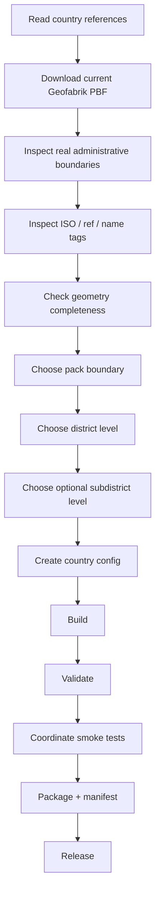
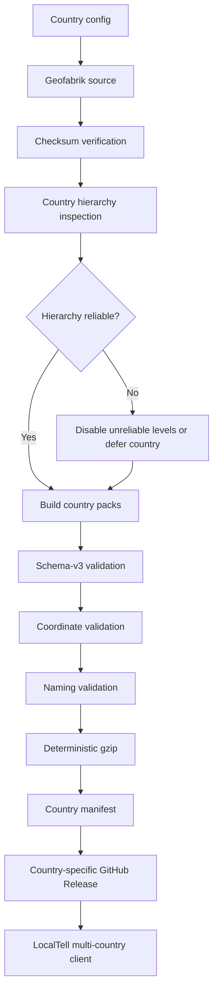

# LocalTell Future Country Geographic Data Expansion Guide

> **Purpose:** Plan and standardize how LocalTell should add geographic data for additional countries after India and Sri Lanka.
>
> **Primary future candidates covered here:** Nepal, Maldives, and Thailand.
>
> **Repository context:** `actionanand/localtell-data`
>
> **Last planning review:** 2026-10-15
>
> **Important:** This document is a future implementation guide, not a declaration that Nepal, Maldives, or Thailand are already supported.

---

## 1. Why this guide exists

LocalTell currently has a working geographic-data model for:

```text
India
  → Region
  → State / Union Territory pack
  → District
  → Subdistrict where reliable
  → Locality

Sri Lanka
  → Province pack
  → District
  → Locality
```

Future countries must **not** be forced into India's administrative terminology or Sri Lanka's exact hierarchy.

The reusable rule is:

> Inspect the country's real OpenStreetMap data first, decide which hierarchy levels are reliable, then map those levels into LocalTell's generic schema-v3 fields.

Do not assume that identical `admin_level` numbers mean identical administrative concepts in every country.

OpenStreetMap itself warns that `admin_level=*` is country-specific. A level that means "province" in one country can mean something different elsewhere.

---

## 2. Core design principles

Every new country should follow these principles.

### 2.1 Keep India isolated

Do not alter India's working directories, release tags, or normal build pipeline merely to add another country.

India remains under its existing workflow.

Future country workspaces belong under:

```text
~/localtell-osm-work/countries/
```

Examples:

```text
~/localtell-osm-work/countries/nepal/
~/localtell-osm-work/countries/maldives/
~/localtell-osm-work/countries/thailand/
```

### 2.2 One configuration per country

Country definitions belong under:

```text
config/countries/
```

Expected future files:

```text
config/countries/nepal.json
config/countries/maldives.json
config/countries/thailand.json
```

A country config should be the authoritative description of:

```text
country code
country name
pack type
workspace
source PBF
checksum source
pack boundary level
district level
optional subdistrict level
required pack IDs
display order
release tag
manifest name
```

### 2.3 Inspect real PBF data before deciding hierarchy

Never build a country configuration solely from Wikipedia, an OSM Wiki table, or ISO subdivision lists.

Those sources help form a hypothesis.

The downloaded PBF decides whether the hierarchy is actually usable.

The workflow is:



### 2.4 Do not invent missing hierarchy

If a lower administrative level is incomplete, inconsistent, or difficult to identify reliably, leave the corresponding LocalTell hierarchy field empty.

For example:

```text
sub_district = NULL
```

is preferable to incorrect data.

Sri Lanka already follows this rule.

### 2.5 Geographic data is canonical data

Do not translate or rename:

```text
country names from the configured catalog
pack names
province/state/atoll names
district names
subdistrict names
locality names
ISO codes
pack IDs
```

App UI labels can be localized.

Canonical geographic values should remain as produced by the country data pipeline.

---

# 3. Existing schema-v3 contract

LocalTell currently uses a shared geographic SQLite schema.

Important `place` fields include:

```text
name
place_type
admin_level
sub_district
district
state
state_code
latitude
longitude
```

These column names remain generic storage fields even when a country uses different terminology.

For example:

| LocalTell field | India | Sri Lanka | Nepal candidate | Thailand candidate | Maldives candidate |
|---|---|---|---|---|---|
| `state` | State / UT | Province | Province | Province | Atoll / capital unit |
| `state_code` | State/UT code | Province code | Province code | Province code | Pack boundary code |
| `district` | District | District | District | District / Amphoe / Khet | Only if a reliable level is confirmed |
| `sub_district` | Subdistrict | `NULL` | Municipality if reliable | Tambon / Khwaeng if reliable | Island or lower unit only if verified |
| `name` | Locality | Locality | Locality | Locality | Locality / island settlement |

The schema should not be renamed per country.

---

# 4. Current Android compatibility gate

The current Android schema-v3 locality resolver expects the pack extent to be represented by an administrative boundary at:

```text
admin_level = 4
```

This means a new country is easiest to add when its chosen pack boundary is a reliable level-4 administrative boundary.

For Nepal, Thailand, and the proposed Maldives hierarchy, level 4 is a plausible first-level pack boundary.

However, this must still be verified from the actual PBF.

## Future non-level-4 countries

If a future country requires a pack boundary at another level, do **not** add logic such as:

```kotlin
if (country == "XX") {
    useAdminLevel(5)
}
```

Instead, generalize the Android resolver to read:

```text
boundary_admin_level
```

from `pack_meta`.

The data pipeline already has the concept of a configured pack boundary admin level, so the Android client can eventually become metadata-driven.

Conceptually:

```text
pack_meta.boundary_admin_level
              ↓
Android resolver pack-extent query
```

That is the preferred future architecture.

---

# 5. Standard future-country workflow

## Phase A — Research only

Before coding:

1. Confirm a Geofabrik extract exists.
2. Record the country ISO alpha-2 code.
3. Read the country's OSM administrative-boundary guidance.
4. Identify candidate pack, district, and subdistrict levels.
5. Identify likely subdivision identifiers such as `ISO3166-2`.
6. Record known special cases.
7. Do not create the final pack list yet.

The result of this phase is only a **candidate hierarchy**.

---

## Phase B — Create an isolated feature branch

Example for Nepal:

```bash
git switch master
git pull --ff-only
git switch -c feature/nepal-geographic-data
```

Examples for later countries:

```text
feature/maldives-geographic-data
feature/thailand-geographic-data
```

Keep one country implementation isolated until it is fully validated.

---

## Phase C — Create country workspace and config

Expected workspace:

```text
~/localtell-osm-work/countries/<country-slug>/
```

Expected structure:

```text
country-workspace/
├── source/
│   ├── <country>-latest.osm.pbf
│   └── <country>-latest.osm.pbf.md5
├── output/
└── release-test/
```

Create:

```text
config/countries/<country>.json
```

Do not copy Sri Lanka's pack list blindly.

Reuse only the generic structure.

---

## Phase D — Download and checksum

Prefer the generic country downloader:

```text
scripts/countries/download_country_source.py
```

The download process should:

```text
download checksum
        ↓
download PBF to temporary file
        ↓
calculate local checksum
        ↓
compare
        ↓
atomically activate verified PBF
```

Never build from an incompletely downloaded PBF.

---

## Phase E — Inspect administrative boundaries

Before any build, inspect the entire PBF.

Collect at least:

```text
admin_level
boundary
ISO3166-2
ref
name
name:en
name:<local-language>
geometry availability
relation ID
```

Useful questions:

```text
How many boundaries exist at each admin level?

Which level represents the intended pack boundary?

Does every expected pack boundary have usable geometry?

Do pack boundaries have stable ISO3166-2 identifiers?

Which lower level represents districts?

Is there complete country-wide lower-level coverage?

Are there duplicate subdivision identifiers?

Are neighboring-country boundaries present in the extract?

Are there obsolete administrative boundaries?

Are there boundary-only helper relations that should be ignored?
```

Do not proceed until these questions are answered.

---

## Phase F — Decide naming policy

Inspect actual multilingual tags before choosing display names.

For each administrative level, compare:

```text
name
name:en
name:<local-language>
official_name
alt_name
short_name
```

A possible policy is:

```text
administrative boundary:
    name:en ?? name

settlement/locality:
    name
```

Sri Lanka currently uses this approach.

But this must **not automatically become the rule for every country**.

For example, a future country may have better canonical Latin-script names in `name`, or may have inconsistent `name:en`.

The country implementation should document why its naming policy was chosen.

---

## Phase G — Build one pack type

The preferred pack level is normally the first reliable subnational level because:

```text
whole country DB
    → can become unnecessarily large

very small local packs
    → too many downloads and too much pack management

first-level subdivision
    → good balance
```

Examples:

```text
India      → State / UT
Sri Lanka  → Province
Nepal      → Province candidate
Thailand   → Province candidate
Maldives   → Administrative atoll / capital candidate
```

Do not choose pack granularity solely from political terminology.

Consider:

```text
database size
number of packs
user travel patterns
boundary reliability
download UX
Android lookup performance
```

---

## Phase H — Validate structure and data

Each generated DB must pass:

```text
SQLite integrity
schema version
required tables
required columns
pack metadata
country metadata
target pack identity
foreign-pack exclusion
allowed place types
coordinate ranges
geometry ring validity
pack boundary geometry
hierarchy consistency
```

For every configured country, validation should explicitly detect:

```text
missing expected boundary
duplicate boundary
invalid geometry
misplaced lower-level boundary
unexpected foreign top-level data
stale metadata
```

---

## Phase I — Coordinate smoke tests

Do not stop after structural validation.

Choose representative coordinates covering:

```text
capital
large city
small town
rural location
border area
remote area
at least one point in every pack
```

For each coordinate verify:

```text
expected pack
expected state_code
expected top-level subdivision
expected district where applicable
name is non-empty
place_type is supported
resolution method is sensible
nearest-place distance is reasonable
```

Do not unnecessarily hard-code an exact nearest locality in permanent tests.

OSM settlement data can improve over time.

Prefer assertions on stable hierarchy.

---

## Phase J — Package and release

Release artifacts should be isolated per country.

Suggested tag convention:

```text
country-<lowercase-country-code>-v1
```

Examples:

```text
country-np-v1
country-mv-v1
country-th-v1
```

Suggested manifest convention:

```text
manifest-NP.json
manifest-MV.json
manifest-TH.json
```

Each release should contain:

```text
one manifest
all country pack .db.gz files
```

Do not publish future-country assets into India's release tag.

---

# 6. Nepal planning

## 6.1 Source

Geofabrik provides a Nepal extract:

```text
https://download.geofabrik.de/asia/nepal-latest.osm.pbf
https://download.geofabrik.de/asia/nepal-latest.osm.pbf.md5
```

Geofabrik's Nepal extract is much larger than Sri Lanka or Maldives, so the pipeline should continue using a single PBF collection pass where practical.

Reference:

```text
https://download.geofabrik.de/asia/nepal.html
```

---

## 6.2 Candidate hierarchy

Current OSM Nepal documentation generally describes:

```text
admin_level 2 → Nepal
admin_level 4 → Province
admin_level 6 → District
admin_level 7 → Municipality / local level
admin_level 9 → Ward
```

The dedicated OSM Nepal province page lists seven province relations with codes such as:

```text
NP-P1
NP-P2
NP-P3
NP-P4
NP-P5
NP-P6
NP-P7
```

Reference:

```text
https://wiki.openstreetmap.org/wiki/Nepal
https://wiki.openstreetmap.org/wiki/Nepal/Boundaries/Provinces
```

### Important Nepal warning

OSM Nepal documentation contains historical/conflicting material.

One older boundary page has represented provinces differently, while the current main Nepal documentation and dedicated province page use level 4.

Therefore:

> Do not encode Nepal's hierarchy until the downloaded current PBF has been inspected directly.

The real PBF must win over wiki assumptions.

---

## 6.3 Recommended LocalTell candidate model

Initial hypothesis:

```text
Country:
    Nepal / NP

Pack:
    Province
    candidate admin_level = 4

District:
    candidate admin_level = 6

Subdistrict:
    Municipality / local level
    candidate admin_level = 7
    enable only if coverage is complete and hierarchy assignment is reliable

Ward:
    candidate admin_level = 9
    probably too granular for the current LocalTell hierarchy
```

Possible schema mapping:

```text
state        = Province
state_code   = Province code
district     = District
sub_district = Municipality, only if validated
name         = Locality
```

---

## 6.4 Nepal pack strategy

Likely one pack per province.

Candidate pack IDs should be derived from the actual subdivision identifiers found in the PBF.

Do not decide whether the LocalTell pack ID should be:

```text
NP-P1
```

or a shorter internal ID until the PBF/config design is reviewed.

Using globally unique country-prefixed pack IDs is strongly preferred for the multi-country client.

For example:

```text
NP-P1
NP-P2
...
```

is naturally collision-resistant.

---

## 6.5 Nepal naming investigation

Nepal has important native Nepali names.

Inspect:

```text
name
name:en
name:ne
```

for:

```text
all provinces
all districts
representative municipalities
representative settlements
```

Do not assume English should automatically replace native settlement names.

Administrative display naming and locality naming may use different policies.

---

## 6.6 Nepal special validation

Nepal testing should include:

```text
Kathmandu Valley
mountain/rural areas
province borders
district borders
remote settlements
locations with sparse settlement nodes
```

Pay particular attention to nearest-place fallback distances in mountain regions.

A long fallback distance may be legitimate because settlements can be sparse, but it should be measured and documented.

---

# 7. Maldives planning

## 7.1 Source

Geofabrik provides a Maldives extract:

```text
https://download.geofabrik.de/asia/maldives-latest.osm.pbf
https://download.geofabrik.de/asia/maldives-latest.osm.pbf.md5
```

The extract is very small compared with Nepal and Thailand.

Reference:

```text
https://download.geofabrik.de/asia/maldives.html
```

This makes Maldives attractive for testing the reusable country pipeline, but administrative consistency is the bigger concern.

---

## 7.2 OSM hierarchy status

The global OSM admin-level table currently marks the Maldives hierarchy as **proposed**, not firmly standardized.

The documented candidate pattern is approximately:

```text
admin_level 2 → Maldives
admin_level 4 → Atolls / Capital (Malé)
admin_level 8 → Islands ? 
admin_level 9 → Districts ?
```

The question marks are important.

Reference:

```text
https://wiki.openstreetmap.org/wiki/Template:Admin_level
```

Therefore Maldives must have a particularly strict real-PBF investigation before implementation.

---

## 7.3 Recommended LocalTell candidate model

Preferred first hypothesis:

```text
Country:
    Maldives / MV

Pack:
    Administrative atoll / capital-level unit
    candidate admin_level = 4

District:
    none until a reliable country-wide level is proven

Subdistrict:
    none until a reliable country-wide level is proven

Locality:
    settlement/island locality from supported OSM place features
```

Possible initial schema mapping:

```text
state        = Administrative atoll / capital unit
state_code   = verified pack subdivision identifier
district     = NULL
sub_district = NULL
name         = Locality / settlement
```

This intentionally favors correctness over filling every field.

---

## 7.4 Do not assume every geographic atoll is an administrative atoll

The Maldives contains geographic atolls and administrative divisions.

LocalTell pack boundaries must follow a consistent administrative model, not merely physical reef geography.

During inspection distinguish:

```text
administrative boundary
natural atoll / island geography
place node
boundary relation
capital-city special case
```

Do not create packs from a named atoll unless it is confirmed to be the desired administrative boundary.

---

## 7.5 Maldives pack-vs-country decision

Because the entire source PBF is small, two designs may initially appear attractive:

```text
A. one DB for the whole Maldives
B. one DB per administrative atoll/capital unit
```

Prefer **B** if reliable level-4 administrative boundaries exist because it fits the current LocalTell client and schema-v3 pack-extent model.

Do not choose a whole-country pack merely because the file is small.

A whole-country pack would require explicitly designing how the Android resolver identifies its outer boundary.

---

## 7.6 Maldives geometry risks

Island geography introduces special validation needs:

```text
multipolygon boundaries
separated island groups
tiny islands
coastline-adjacent coordinates
representative points
water between islands
```

A coordinate in the sea must not resolve merely because it lies inside an overly broad rectangular extent.

Pack validation must rely on real administrative polygon geometry.

Coordinate smoke tests should include:

```text
Malé
inhabited islands
remote islands
different administrative atolls
near-coast points
water points expected not to resolve
```

---

## 7.7 Maldives naming investigation

Inspect at least:

```text
name
name:en
name:dv
```

Do not automatically transliterate Dhivehi locality names.

Decide administrative display policy only after checking tag coverage.

---

# 8. Thailand planning

## 8.1 Source

Geofabrik provides a Thailand extract:

```text
https://download.geofabrik.de/asia/thailand-latest.osm.pbf
https://download.geofabrik.de/asia/thailand-latest.osm.pbf.md5
```

Reference:

```text
https://download.geofabrik.de/asia/thailand.html
```

Thailand's PBF is large enough that collecting the source once and building all packs from the resulting in-memory/indexed representation is important.

---

## 8.2 Candidate hierarchy

OSM's Thailand documentation describes the provincial administration as:

```text
Thailand
    → Province / Changwat
        → District / Amphoe
            → Subdistrict / Tambon
                → Village / Muban
```

The corresponding commonly documented administrative levels are:

```text
admin_level 2  → Country
admin_level 4  → Province
admin_level 6  → District
admin_level 8  → Subdistrict
admin_level 10 → Village
```

Reference:

```text
https://wiki.openstreetmap.org/wiki/Thailand/Places_and_Boundaries
```

Thailand also has local-administration boundaries that can overlap or differ from the provincial hierarchy.

This makes strict hierarchy filtering essential.

---

## 8.3 Recommended LocalTell candidate model

Initial hypothesis:

```text
Country:
    Thailand / TH

Pack:
    Province
    candidate admin_level = 4

District:
    District / Amphoe
    candidate admin_level = 6

Subdistrict:
    Subdistrict / Tambon
    candidate admin_level = 8

Locality:
    neighbourhood
    suburb
    locality
    hamlet
    village
    town
    city
```

Schema mapping:

```text
state        = Province
state_code   = Province subdivision code
district     = Amphoe / district
sub_district = Tambon / subdistrict
name         = Locality
```

This is a strong match for LocalTell's existing schema if the real PBF coverage is complete.

---

## 8.4 Thailand special cases

Thailand is not just a simple province → district → subdistrict hierarchy.

The PBF investigation must explicitly account for:

### Bangkok

Bangkok has special administrative terminology:

```text
Bangkok
    → Khet
        → Khwaeng
```

These need to map consistently into the generic:

```text
state
district
sub_district
```

without creating Bangkok-only DB schema rules.

### Pattaya

Pattaya has special local-administration status.

Do not accidentally treat local municipality boundaries as the primary country hierarchy.

### Municipalities and SAOs

Thailand has local administrative organizations that can overlap the provincial-administration structure.

The build must distinguish the hierarchy LocalTell wants from parallel municipal/local-government boundaries.

Do not assign hierarchy solely because:

```text
boundary=administrative
```

is present.

Use the configured levels plus verified subdivision identity and containment.

---

## 8.5 Thailand naming investigation

Inspect:

```text
name
name:en
name:th
```

for:

```text
provinces
districts
subdistricts
cities
villages
```

OSM Thailand guidance notes naming conventions can differ between administrative boundaries and place nodes.

Therefore administrative-name handling should be explicitly tested before deciding between:

```text
name
```

and:

```text
name:en ?? name
```

Local settlement names should remain canonical source data.

---

## 8.6 Thailand scale considerations

Thailand will likely create many more pack-build operations than Sri Lanka.

The pipeline should:

```text
parse source once
        ↓
retain reusable feature collection/index
        ↓
filter/build each province
```

Do not parse the complete Thailand PBF once per province.

Measure:

```text
source parse time
peak memory
largest province DB
largest gzip
total country download size
build time
validation time
```

before release.

---

# 9. Country configuration template

Do not copy this verbatim without PBF inspection.

Use it as a structural template:

```json
{
  "countryCode": "XX",
  "countryName": "Example Country",
  "packType": "province",
  "expectedDistrictCount": 0,
  "requiredPackIds": [],
  "workspace": "~/localtell-osm-work/countries/example-country",
  "source": {
    "url": "https://download.geofabrik.de/.../example-latest.osm.pbf",
    "checksumUrl": "https://download.geofabrik.de/.../example-latest.osm.pbf.md5",
    "fileName": "example-latest.osm.pbf",
    "checksumFileName": "example-latest.osm.pbf.md5"
  },
  "hierarchy": {
    "packBoundaryAdminLevel": "4",
    "districtAdminLevel": null,
    "subDistrictAdminLevel": null
  },
  "release": {
    "repository": "actionanand/localtell-data",
    "tag": "country-xx-v1",
    "manifestName": "manifest-XX.json"
  },
  "packs": []
}
```

Populate the final fields only after real-data inspection.

---

# 10. Proposed command convention

As the number of countries grows, avoid creating substantial duplicated Python logic.

The generic scripts should remain parameterized by country configuration.

Ideal underlying usage:

```bash
python scripts/countries/download_country_source.py \
  --config config/countries/nepal.json
```

Likewise:

```bash
python scripts/countries/inspect_country_boundaries.py \
  --config config/countries/nepal.json

python scripts/countries/build_country.py \
  --config config/countries/nepal.json \
  --force \
  --progress

python scripts/countries/validate_country.py \
  --config config/countries/nepal.json

python scripts/countries/package_country.py \
  --config config/countries/nepal.json

python scripts/countries/generate_country_manifest.py \
  --config config/countries/nepal.json
```

Convenience npm scripts may be added:

```text
data:np:download
data:np:inspect
data:np:build
data:np:validate
data:np:package
data:np:manifest
data:np:test

data:mv:...
data:th:...
```

But npm aliases must remain thin wrappers around the generic country pipeline.

---

# 11. Boundary inspection checklist

For every new country, save the results of a first real PBF inspection.

Example report:

```text
Country: XX

PBF:
    path
    size
    checksum

Administrative counts:
    level 2 = ...
    level 3 = ...
    level 4 = ...
    level 5 = ...
    level 6 = ...
    level 7 = ...
    level 8 = ...
    level 9 = ...
    level 10 = ...

Candidate pack boundaries:
    expected = ...
    usable = ...
    missing = ...
    duplicate = ...
    invalid geometry = ...

Candidate districts:
    expected = ...
    usable = ...

Candidate subdistricts:
    expected = ...
    usable = ...

Foreign/noisy boundaries:
    ...

Naming coverage:
    name = ...
    name:en = ...
    native-language name = ...

Decision:
    pack boundary = level ...
    district = level ... / disabled
    subdistrict = level ... / disabled
```

Keep this output in development notes until the country design is stable.

---

# 12. Settlement policy

LocalTell's supported settlement types currently include:

```text
neighbourhood
suburb
locality
hamlet
village
town
city
```

Do not automatically add every country's `place=*` vocabulary.

Before adding a new place type:

1. inspect how it is used in that country;
2. confirm it represents a useful locality;
3. check interaction with polygon priority;
4. check nearest-place fallback;
5. add regression tests.

Country onboarding should normally reuse the existing supported settlement set first.

---

# 13. Polygon and fallback policy

Current conceptual resolution:

```text
coordinate
    ↓
inside installed pack boundary?
    ├── no → try next installed pack
    └── yes
          ↓
      settlement polygon match?
          ├── yes → most specific supported polygon
          └── no
                ↓
            nearest named settlement
```

Do not change this algorithm solely because a new country is added.

Instead measure country-specific behavior.

Investigate changes only if real coordinate validation shows a systematic problem.

Examples:

```text
mountain areas in Nepal may have larger fallback distances
island geography in Maldives needs careful boundary geometry
dense Thai settlements may return very specific neighbourhoods
```

A different result is not automatically a bug.

---

# 14. Coordinate regression strategy

Permanent regression fixtures should focus on stable expectations.

Prefer:

```text
coordinate
expected pack
expected state_code
expected state/province/atoll
expected district where stable
non-empty locality
allowed place type
valid resolution method
reasonable fallback distance
```

Avoid:

```text
coordinate must always return exact locality X
```

unless that locality is a deliberately stable test fixture.

OSM source data changes over time.

---

# 15. Naming regression strategy

For every country, include tests that reflect the selected naming policy.

Examples:

```text
administrative feature with preferred language tag
administrative feature without preferred language tag
settlement with both name and name:en
native-script administrative feature
missing optional language tag
```

The test should prove the chosen policy, not a global assumption.

---

# 16. Release integrity checklist

Before creating a country v1 release:

```text
[ ] source checksum verified
[ ] hierarchy inspection passed
[ ] all expected pack boundaries usable
[ ] expected lower hierarchy validated
[ ] all DBs built
[ ] all DBs pass integrity/schema validation
[ ] representative coordinate smoke tests passed
[ ] naming policy verified
[ ] deterministic gzip produced
[ ] gzip decompresses back to raw DB
[ ] SHA-256 generated
[ ] manifest regenerated after final build
[ ] tests pass
[ ] git diff --check passes
[ ] documentation updated
[ ] release tag does not already exist
[ ] correct fresh assets selected
```

After publishing:

```bash
gh release view country-xx-v1 \
  --repo actionanand/localtell-data
```

Verify asset names:

```bash
gh release view country-xx-v1 \
  --repo actionanand/localtell-data \
  --json assets \
  --jq '.assets[].name'
```

Never reuse packages or manifests produced before the final data/code correction.

---

# 17. Android client integration

The Android client should not require a new resolver for every country.

Expected future model:

```text
Configured country manifest sources
        ↓
India manifest
Sri Lanka manifest
Nepal manifest
Maldives manifest
Thailand manifest
        ↓
generic RemotePack model
        ↓
existing downloader
        ↓
existing PackStore
        ↓
schema-v3 OfflineLocalityResolver
```

Country-specific behavior belongs primarily in:

```text
country catalog
manifest validation
Offline Data presentation
pack labels
```

not in:

```text
download implementation
SQLite activation
locality resolver
Journey resolver
Easy resolver
Home resolver
```

---

# 18. Client translation policy

Adding geographic support for a country does **not** automatically require adding that country's language as a LocalTell UI language.

These are separate concerns:

```text
Country data support
        ≠
App UI translation
```

For example, Nepal geographic support can be released while the LocalTell UI remains:

```text
English
Tamil
Sanskrit
```

if that is the product decision.

A Nepali UI translation can be added separately later.

Likewise for:

```text
Dhivehi
Thai
Sinhala
```

Canonical geographic names are never translated simply because the UI language changes.

---

# 19. Recommended implementation order

A reasonable future priority is:

```text
Sri Lanka
    ✅ completed

Nepal
    ↓
good test of larger PBF + province/district hierarchy

Maldives
    ↓
small dataset but requires careful admin/geometry investigation

Thailand
    ↓
larger dataset and more complex parallel administrative systems
```

This is an engineering recommendation, not a product commitment.

Maldives may move earlier if the real PBF inspection proves its level-4 boundaries clean and complete.

---

# 20. Country-specific risk summary

| Country | Candidate pack | Lower hierarchy | Main risk |
|---|---|---|---|
| Nepal | Province, likely level 4 | District 6; municipality 7 candidate | OSM documentation/history must be reconciled with real PBF; mountainous sparse-locality fallback |
| Maldives | Atoll/capital, proposed level 4 | uncertain; islands around level 8 candidate | proposed/incomplete admin conventions, island multipolygons, geographic vs administrative atolls |
| Thailand | Province, likely level 4 | district 6, subdistrict 8 | Bangkok/Pattaya special cases, parallel local administration, large source |

---

# 21. What must be verified at implementation time

Because OSM evolves, the following information in this planning document must be treated as provisional:

```text
admin-level assignments
boundary counts
subdivision codes
name/name:en coverage
geometry completeness
district/subdistrict completeness
pack counts
OSM relation IDs
PBF size
```

When a country is actually implemented:

> Download the current PBF and repeat the inspection from zero.

Do not trust an old inspection merely because this document exists.

---

# 22. Research references

## General OSM administrative hierarchy

```text
https://wiki.openstreetmap.org/wiki/Key:admin_level
https://wiki.openstreetmap.org/wiki/Template:Admin_level
```

Important principle:

> `admin_level` values are country-specific and should not be interpreted globally without country-specific inspection.

## Geofabrik Asia

```text
https://download.geofabrik.de/asia.html
```

## Nepal

```text
https://download.geofabrik.de/asia/nepal.html
https://wiki.openstreetmap.org/wiki/Nepal
https://wiki.openstreetmap.org/wiki/Nepal/Boundaries/Provinces
```

## Maldives

```text
https://download.geofabrik.de/asia/maldives.html
https://wiki.openstreetmap.org/wiki/Template:Admin_level
```

The OSM Maldives hierarchy is currently documented as proposed; real-data inspection is mandatory.

## Thailand

```text
https://download.geofabrik.de/asia/thailand.html
https://wiki.openstreetmap.org/wiki/Thailand/Places_and_Boundaries
```

---

# 23. Future-country decision template

Before writing build code for any future country, fill out this section.

```text
Country:
ISO alpha-2:
Geofabrik source:
Source checksum:

Current PBF date:

Candidate pack type:
Candidate pack boundary admin level:

Expected pack identities:
Identity tag:
    ISO3166-2 / ref / other

District admin level:
District identity mechanism:

Subdistrict admin level:
Enabled:
Reason:

Administrative naming policy:

Settlement naming policy:

Special administrative cases:

Foreign/noisy boundaries observed:

Schema-v3 compatible without client change:
    yes / no

Android level-4 boundary compatible:
    yes / no

Coordinate tests selected:

Release tag:
Manifest name:

Final decision:
    ready / needs investigation / deferred
```

Do not move from "needs investigation" to "ready" without real PBF evidence.

---

# 24. Final architecture

The desired long-term pipeline is:



The country framework should remain:

```text
configuration-driven
country-isolated
schema-compatible
strictly validated
offline-first
future-ready
```

The most important rule is:

> **Never force a country's geography into an assumed hierarchy. Inspect the current source, configure only what is reliable, and leave uncertain hierarchy empty rather than publishing incorrect locality data.**
