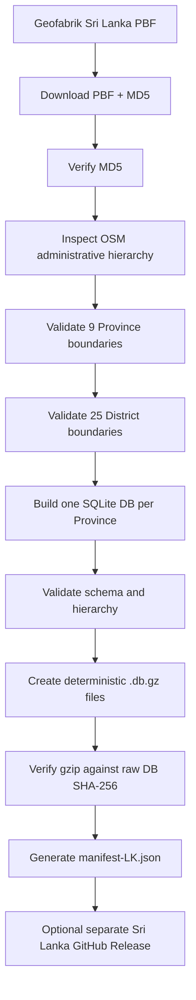
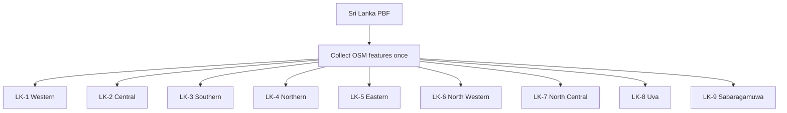

# LocalTell Sri Lanka Geographic Data — Build & Preparation Guide

This guide documents how Sri Lanka offline geographic data is prepared for LocalTell using the `actionanand/localtell-data` repository.

The Sri Lanka pipeline is intentionally isolated from the existing India pipeline. India remains LocalTell's primary dataset and its State/UT build, validation, manifest, and release flow are not modified by the Sri Lanka implementation.

> **Repository:** `https://github.com/actionanand/localtell-data`

---

## 1. Purpose

LocalTell resolves localities offline from downloaded SQLite geographic packs.

For Sri Lanka, the goal is to build a separate set of province-level offline packs while preserving compatibility with LocalTell's existing schema-v3 geographic database.

Sri Lanka support is designed as the first implementation of a reusable **Other Countries** pipeline.

The same framework can later support countries such as:

- Maldives
- Nepal
- Thailand

Each country gets its own configuration, workspace, hierarchy rules, manifest, and release assets.

---

## 2. India must remain isolated

The Sri Lanka pipeline must not modify or reuse India's working directories.

India continues to use the existing files such as:

```text
config/india-packs.json

scripts/build_state.py
scripts/build_region.py
scripts/validate_state.py
scripts/validate_region.py
scripts/package_state.py
scripts/generate_manifest.py
scripts/publish_release.py
scripts/state_tools.py
```

Sri Lanka uses separate files under:

```text
config/countries/
scripts/countries/
```

and a separate workspace:

```text
~/localtell-osm-work/countries/sri-lanka/
```

The country framework rejects use of the India workspace.

---

## 3. High-level flow



Publishing is deliberately separate from the normal build pipeline.

---

## 4. Source data

Sri Lanka data comes from Geofabrik's Sri Lanka OpenStreetMap extract.

The configured files are:

```text
sri-lanka-latest.osm.pbf
sri-lanka-latest.osm.pbf.md5
```

They are downloaded into:

```text
~/localtell-osm-work/countries/sri-lanka/source/
```

Expected layout:

```text
~/localtell-osm-work/countries/sri-lanka/
├── source/
│   ├── sri-lanka-latest.osm.pbf
│   └── sri-lanka-latest.osm.pbf.md5
├── output/
└── release-test/
```

The PBF is intentionally stored outside the Git repository because it is a large source file and is periodically updated by Geofabrik.

---

## 5. Downloading the Sri Lanka PBF

Run:

```bash
npm run data:lk:download
```

The downloader:

1. creates the Sri Lanka workspace if needed;
2. downloads the Geofabrik MD5 file;
3. downloads the PBF to a temporary `.part` file;
4. calculates the local MD5;
5. compares it against the Geofabrik MD5;
6. only after successful verification atomically replaces the final PBF;
7. removes failed partial downloads.

Example successful output:

```text
Downloaded and verified:
/home/actionanand/localtell-osm-work/countries/sri-lanka/source/sri-lanka-latest.osm.pbf
```

---

## 6. Existing-source verification

Running the download command again does not blindly trust an existing file.

Run:

```bash
npm run data:lk:download
```

If the existing PBF checksum still matches the stored checksum, the downloader reports:

```text
Verified existing source:
/home/actionanand/localtell-osm-work/countries/sri-lanka/source/sri-lanka-latest.osm.pbf
```

This avoids unnecessary downloads while still verifying source integrity.

The source can also be checked manually:

```bash
md5sum ~/localtell-osm-work/countries/sri-lanka/source/sri-lanka-latest.osm.pbf

cat ~/localtell-osm-work/countries/sri-lanka/source/sri-lanka-latest.osm.pbf.md5
```

The two MD5 values must match.

---

## 7. Sri Lanka country configuration

Sri Lanka is defined in:

```text
config/countries/sri-lanka.json
```

The configuration contains:

- country code;
- country name;
- pack type;
- workspace;
- source URLs;
- source file names;
- administrative hierarchy;
- required province pack IDs;
- district mappings;
- release metadata.

Core country values:

```json
{
  "countryCode": "LK",
  "countryName": "Sri Lanka",
  "packType": "province",
  "workspace": "~/localtell-osm-work/countries/sri-lanka"
}
```

---

## 8. Province pack model

Sri Lanka is divided into nine LocalTell offline packs, one per province.

| Pack ID | Province |
|---|---|
| `LK-1` | Western Province |
| `LK-2` | Central Province |
| `LK-3` | Southern Province |
| `LK-4` | Northern Province |
| `LK-5` | Eastern Province |
| `LK-6` | North Western Province |
| `LK-7` | North Central Province |
| `LK-8` | Uva Province |
| `LK-9` | Sabaragamuwa Province |

Expected output names:

```text
LK-1.db
LK-2.db
LK-3.db
LK-4.db
LK-5.db
LK-6.db
LK-7.db
LK-8.db
LK-9.db
```

Compressed forms:

```text
LK-1.db.gz
...
LK-9.db.gz
```

Using `LK-*` avoids collisions with India's short State/UT IDs.

---

## 9. Real PBF hierarchy investigation

Before building any database, the downloaded PBF was inspected directly.

Run:

```bash
npm run data:lk:inspect
```

The first real inspection confirmed:

```text
Expected Sri Lanka provinces usable: 9/9
missing: []
duplicates: []
expected without usable geometry: []
```

All nine required province polygons were therefore present and usable.

The initial raw administrative counts were:

```text
admin_level 4 → 13 boundaries
admin_level 5 → 36 boundaries
admin_level 6 → 4 boundaries
admin_level 7 → 6 boundaries
admin_level 8 → 23 boundaries
```

These raw counts include nearby or noisy OpenStreetMap administrative objects, so they must not be treated as the Sri Lanka hierarchy without filtering.

---

## 10. Why raw OSM admin levels cannot be trusted blindly

The PBF included extra objects such as:

```text
Tamil Nadu                 ISO=IN-TN
District border            ISO=-
Ramanathapuram             ISO=-
Uva Province - Central Province Boundary
```

These objects are useful OSM map data but must not become LocalTell Sri Lanka hierarchy records.

Therefore, LocalTell uses:

- configured administrative level;
- exact `ISO3166-2` subdivision code;
- valid assembled geometry;
- configured province-to-district membership.

Names alone are not used as authoritative hierarchy identity.

---

## 11. Final Sri Lanka hierarchy

The real PBF established the following LocalTell hierarchy:

```text
admin_level 4
    → Province

admin_level 5
    → District

subdistrict
    → unavailable / intentionally disabled
```

The configuration therefore uses:

```json
"hierarchy": {
  "packBoundaryAdminLevel": "4",
  "districtAdminLevel": "5",
  "subDistrictAdminLevel": null
}
```

This is deliberate.

Levels 6, 7, and 8 were inspected, but they are too incomplete or inconsistent to represent Sri Lanka-wide subdistrict data.

LocalTell therefore leaves:

```text
sub_district = NULL
```

rather than writing unreliable data.

---

## 12. Confirmed Sri Lanka districts

The real PBF contains the 25 expected Sri Lankan districts with `ISO3166-2` identifiers.

### Western Province — `LK-1`

```text
LK-11  Colombo
LK-12  Gampaha
LK-13  Kalutara
```

### Central Province — `LK-2`

```text
LK-21  Kandy
LK-22  Matale
LK-23  Nuwara Eliya
```

### Southern Province — `LK-3`

```text
LK-31  Galle
LK-32  Matara
LK-33  Hambantota
```

### Northern Province — `LK-4`

```text
LK-41  Jaffna
LK-42  Kilinochchi
LK-43  Mannar
LK-44  Vavuniya
LK-45  Mullaitivu
```

### Eastern Province — `LK-5`

```text
LK-51  Batticaloa
LK-52  Ampara
LK-53  Trincomalee
```

### North Western Province — `LK-6`

```text
LK-61  Kurunegala
LK-62  Puttalam
```

### North Central Province — `LK-7`

```text
LK-71  Anuradhapura
LK-72  Polonnaruwa
```

### Uva Province — `LK-8`

```text
LK-81  Badulla
LK-82  Monaragala
```

### Sabaragamuwa Province — `LK-9`

```text
LK-91  Ratnapura
LK-92  Kegalle
```

Total:

```text
9 Provinces
25 Districts
```

---

## 13. Strict hierarchy filtering

Sri Lanka hierarchy data is not selected merely because a polygon lies geographically inside a province.

A valid province boundary must satisfy:

```text
admin_level == 4
ISO3166-2 == configured province code
usable polygon geometry exists
```

A valid district boundary must satisfy:

```text
admin_level == 5
ISO3166-2 is in that province's configured districtCodes
usable polygon geometry exists
```

Examples such as these must not become districts:

```text
District border
Ramanathapuram
any level-5 boundary without an approved Sri Lankan district ISO code
```

---

## 14. LocalTell schema mapping

Sri Lanka keeps LocalTell's existing schema-v3 column names for Android compatibility.

| LocalTell field | Sri Lanka meaning |
|---|---|
| `state` | Province name |
| `state_code` | Province ISO code such as `LK-1` |
| `district` | District name |
| `sub_district` | `NULL` |
| `name` | Locality / settlement / administrative feature name |
| `place_type` | settlement/admin type |
| `latitude` | representative latitude |
| `longitude` | representative longitude |

The schema is **not renamed** to `province` or `division`.

This avoids an Android schema change.

---

## 15. `state_code` meaning

A critical rule is:

> `state_code` always stores the containing province code.

For example:

```text
Western Province → state_code = LK-1
```

District ISO codes such as `LK-11` are used for hierarchy filtering and validation but are not stored in `state_code`.

This preserves the existing LocalTell schema semantics.

---

## 16. Supported locality types

Sri Lanka uses the same LocalTell settlement types as the existing geographic pipeline:

```text
neighbourhood
suburb
locality
hamlet
village
town
city
```

Administrative polygons use:

```text
administrative_boundary
```

Unsupported place types are not introduced into the database.

---

## 17. Database schema

Each province database remains schema-v3 compatible.

Required tables:

```text
pack_meta
place
place_geometry
place_geometry_rtree
```

Important `place` columns include:

```text
id
name
place_type
admin_level
sub_district
district
state
state_code
latitude
longitude
```

No Sri-Lanka-specific table is required.

---

## 18. Pack metadata

Each DB contains metadata describing the country and pack.

Example:

```text
schema_version       = 3
pack_id              = LK-1
pack_name            = Western Province
pack_version         = 1
country_code         = LK
country_name         = Sri Lanka
pack_type            = province
boundary_code        = LK-1
boundary_admin_level = 4
```

The configured district codes are also tracked so validation can detect a DB produced with stale hierarchy configuration.

---

## 19. Building province databases

Once inspection reports all configured provinces and districts as usable, run:

```bash
npm run data:lk:build
```

The builder is designed to collect the Sri Lanka PBF once and then build all nine province packs from that in-memory feature collection.

Conceptually:



This avoids parsing the complete PBF separately for every province.

---

## 20. Province filtering

For each target province, the builder:

1. identifies the configured level-4 province boundary;
2. rejects foreign level-4 extents;
3. retains approved district boundaries;
4. retains supported settlements whose representative points fall inside the province;
5. resolves Province and District hierarchy;
6. leaves `sub_district` empty;
7. writes schema-v3 SQLite.

Nearby Indian boundary data such as Tamil Nadu does not become part of a Sri Lanka province pack.

---

## 21. Geometry handling

The country builder reuses LocalTell's existing geographic primitives.

The pipeline supports:

- relation ring assembly;
- closed polygon rings;
- polygon simplification;
- bounding boxes;
- representative/interior points;
- point-in-polygon lookup;
- RTree population for build-time/desktop tooling.

The Sri Lanka implementation deliberately does not redesign LocalTell's existing geometry contract.

---

## 22. Inspecting before build

The normal safe workflow is:

```bash
npm run data:lk:inspect
```

A successful strict inspection should report conceptually:

```text
Expected Sri Lanka provinces usable: 9/9
Expected Sri Lanka districts usable: 25/25

missing provinces: []
duplicate provinces: []
unusable provinces: []

missing districts: []
duplicate districts: []
unusable districts: []
misplaced districts: []

subdistrict hierarchy: disabled / unavailable
```

Warnings about unrelated boundary objects may be reported separately.

Warnings do not automatically mean that the Sri Lanka dataset is invalid.

---

## 23. Validating generated databases

After building:

```bash
npm run data:lk:validate
```

Validation checks include:

- SQLite integrity;
- schema version;
- required tables;
- required columns;
- pack metadata;
- country metadata;
- target province identity;
- no foreign province `state_code`;
- approved district hierarchy;
- valid place types;
- valid latitude/longitude ranges;
- valid closed geometry rings;
- usable province extent geometry;
- valid point-in-polygon behavior;
- `sub_district` remains `NULL` when disabled.

A failed pack causes the Sri Lanka validation stage to fail.

---

## 24. Packaging databases

After successful validation:

```bash
npm run data:lk:package
```

Each DB becomes a deterministic gzip:

```text
LK-1.db   → LK-1.db.gz
...
LK-9.db   → LK-9.db.gz
```

Packaging uses:

```text
gzip compression level = 9
mtime = 0
embedded filename = empty
```

This makes gzip output reproducible for identical input.

Before accepting a package, the pipeline fully decompresses it and verifies that the decompressed SHA-256 matches the original raw SQLite DB.

---

## 25. Manifest generation

After packaging:

```bash
npm run data:lk:manifest
```

The generated manifest is separate from India's manifest:

```text
manifest-LK.json
```

It is written to the Sri Lanka release-test workspace.

Each entry includes fields such as:

```json
{
  "id": "LK-1",
  "name": "Western Province",
  "adminCode": "LK-1",
  "version": 1,
  "displayOrder": 1,
  "downloadUrl": ".../LK-1.db.gz",
  "sha256": "...",
  "compressedBytes": 123456,
  "uncompressedBytes": 456789
}
```

Before writing the manifest, the generator verifies:

- raw DB exists;
- gzip exists;
- gzip fully decompresses;
- decompressed content matches the raw DB;
- DB metadata matches current configuration;
- pack ordering is correct.

---

## 26. End-to-end pipeline

After all real-data inspection rules are confirmed, the complete local pipeline is:

```bash
npm run data:lk:all
```

Conceptually it performs:

```text
download
   ↓
checksum verification
   ↓
boundary inspection
   ↓
build
   ↓
validate
   ↓
package
   ↓
manifest
```

It intentionally does **not** publish a GitHub release.

---

## 27. Individual commands

```bash
npm run data:lk:download
npm run data:lk:inspect
npm run data:lk:build
npm run data:lk:validate
npm run data:lk:package
npm run data:lk:manifest
npm run data:lk:all
npm run data:lk:test
```

Sri Lanka is the default country config for these commands.

The underlying country scripts can also support:

```text
--config <country-config-file>
```

for future countries.

---

## 28. Testing

Run the full repository test suite:

```bash
python3 -m unittest discover -s tests -v
```

Also run:

```bash
git diff --check
```

Existing India tests must remain green.

Country-specific tests cover areas such as:

- province configuration;
- district code uniqueness;
- workspace isolation;
- path traversal protection;
- deterministic gzip;
- ISO subdivision identity;
- foreign province filtering;
- hierarchy behavior.

---

## 29. Workspace safety

Country workspaces must live below:

```text
~/localtell-osm-work/countries/
```

Allowed:

```text
~/localtell-osm-work/countries/sri-lanka
~/localtell-osm-work/countries/nepal
```

Not allowed:

```text
~/localtell-osm-work
~/localtell-osm-work/source
~/localtell-osm-work/output
~/localtell-osm-work/release-test
~/localtell-osm-work/countries
```

This prevents the international pipeline from overwriting India's existing source or build outputs.

---

## 30. Release isolation

Sri Lanka must never publish under India's existing data release tag.

Sri Lanka uses its own release metadata:

```text
country-lk-v1
```

Expected Sri Lanka release assets would be:

```text
manifest-LK.json

LK-1.db.gz
LK-2.db.gz
LK-3.db.gz
LK-4.db.gz
LK-5.db.gz
LK-6.db.gz
LK-7.db.gz
LK-8.db.gz
LK-9.db.gz
```

India's release assets remain independent.

---

## 31. Updating Sri Lanka later

When Geofabrik publishes newer Sri Lanka data:

```bash
npm run data:lk:download -- --force
```

Then re-run:

```bash
npm run data:lk:inspect
npm run data:lk:build -- --force
npm run data:lk:validate
npm run data:lk:package
npm run data:lk:manifest
```

Always inspect the administrative hierarchy again before trusting a new source snapshot.

OpenStreetMap data can evolve over time.

---

## 32. Why subdistrict is intentionally empty

It is tempting to fill every schema field, but incorrect hierarchy data is worse than missing optional data.

The actual downloaded Sri Lanka PBF showed:

```text
admin_level 6 → only 4 boundaries
admin_level 7 → only 6 boundaries
admin_level 8 → only 23 boundaries
```

This is not enough to represent the entire country consistently.

Therefore LocalTell deliberately stores:

```text
sub_district = NULL
```

for Sri Lanka.

If Sri Lanka OSM lower-level coverage becomes complete in the future, the configuration can be revisited after another real-data inspection.

---

## 33. Why Tamil Nadu appeared in inspection

The Sri Lanka Geofabrik extract contained nearby administrative information including:

```text
Tamil Nadu
ISO3166-2 = IN-TN
```

This does not mean Tamil Nadu is included as a Sri Lankan pack.

It is treated as unrelated foreign level-4 data and must remain only an inspection warning.

The actual Sri Lanka pack builder uses exact configured `LK-*` province identities and rejects foreign province extents.

---

## 34. Key design principle

The Sri Lanka pipeline follows this rule:

> **Configuration identifies the hierarchy; geography confirms membership; unrelated OSM data never defines LocalTell hierarchy by accident.**

For Sri Lanka:

```text
Country
  Sri Lanka / LK

Province
  9 configured LK-1 ... LK-9 boundaries

District
  25 configured LK-xx district boundaries

Subdistrict
  intentionally unavailable

Locality
  OSM settlement records inside the target province
```

---

## 35. Current implementation status

At the time this guide was written:

```text
Sri Lanka source download       ✅
MD5 verification                ✅
Existing-source revalidation    ✅
9 province discovery            ✅
Real PBF hierarchy inspection   ✅
25 district mapping             ✅
Subdistrict policy              ✅ disabled intentionally
India isolation                 ✅
Source download/checksum        COMPLETE
Province inspection             9/9
District inspection             25/25
Raw province DB build           9/9
Raw DB validation               9/9
Content sanity check            PASSED
Deterministic gzip packaging    9/9
manifest-LK.json generation     COMPLETE
Publishing                      NOT YET DONE
```

The first successful raw DB sizes were approximately 216K, 268K, 176K, 168K,
160K, 152K, 156K, 224K, and 204K for LK-1 through LK-9 respectively. The
corresponding deterministic gzip sizes were about 61K, 79K, 48K, 44K, 41K,
37K, 44K, 71K, and 59K: roughly 0.5 MiB total. All current
non-administrative place rows resolved to an approved district; `state` and
`state_code` remain Province / LK-1…LK-9, while `sub_district` is NULL.

This status section should be updated after the first complete nine-province production build succeeds.

---

## 36. Future countries

The `scripts/countries/` framework is intended to support additional countries without modifying India.

A future country should provide its own config, for example:

```text
config/countries/nepal.json
config/countries/maldives.json
config/countries/thailand.json
```

Do **not** assume that another country's hierarchy matches Sri Lanka.

For every new country:

1. download its real PBF;
2. inspect its actual OSM hierarchy;
3. identify trustworthy subdivision codes;
4. configure pack boundaries;
5. configure lower hierarchy only where coverage is reliable;
6. build into its own workspace;
7. generate a separate manifest/release.

---

## Final summary

Sri Lanka LocalTell data is created from a verified Geofabrik OSM PBF, separated into nine ISO-identified Province packs, enriched with 25 strictly configured District boundaries, written into the existing LocalTell schema-v3 SQLite format, validated, deterministically compressed, and represented by a dedicated Sri Lanka manifest.

The most important safety decisions are:

- India remains untouched.
- Sri Lanka uses a separate workspace and release.
- Province identity is based on `ISO3166-2`.
- District identity is explicitly configured from the real PBF.
- noisy OSM administrative objects are excluded from hierarchy.
- incomplete lower-level administrative data is not invented.
- `sub_district` remains `NULL` until reliable country-wide data exists.
